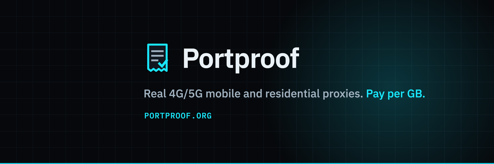

[](https://portproof.org)

# Portproof MCP

[](https://lobehub.com/mcp/portproofas-portproof-mcp)

**Connect your agent to Portproof.**

Check your GB balance, choose a pool and build a proxy connection from your MCP
client. Mobile 4G/5G and residential traffic share one prepaid balance.

[Website](https://portproof.org) · [Setup guide](https://portproof.org/guides/proxy-mcp-server-for-ai-agents) · [Documentation](https://portproof.org/docs#mcp) · [npm](https://www.npmjs.com/package/@portproof/mcp) · [Status](https://portproof.org/status)

Local stdio server · Node.js 20+ · MIT · `@portproof/mcp@0.2.4`

## From settings to a connection

| Your workflow | MCP tools |
| --- | --- |
| Check pricing and current coverage | `get_pricing`, `list_countries`, `get_status` |
| See your remaining traffic | `get_traffic` |
| Choose HTTP or SOCKS5, country and rotation | `build_proxy_url` |
| Test a connection | `test_connection` |
| Buy traffic with your confirmation | `buy_traffic` |

Both pools are shared. A sticky session prefers the same device but does not
reserve it, and its IP address may still change.

This server covers proxy traffic and private mobile ports. SMS numbers and eSIMs
are sold too, in the web shop and through the API, but have no tools here.

## Connect an MCP client

Add this to a client supporting local **stdio** MCP servers. You can explore
pricing, service status and current coverage without an API key.
The same stdio config works in other MCP clients such as Kimi Code CLI.

```json
{
  "mcpServers": {
    "portproof": {
      "command": "npx",
      "args": ["-y", "@portproof/mcp@0.2.4"]
    }
  }
}
```

### Claude Desktop

Open **Settings → Developer → Edit Config** and merge the JSON above into
`claude_desktop_config.json`. Keep any existing entries under `mcpServers`.
Save the file, fully quit Claude Desktop, then reopen it.
[Official setup instructions](https://modelcontextprotocol.io/docs/develop/connect-local-servers).

### Cursor

Merge the JSON above into your personal `~/.cursor/mcp.json` file. This makes
Portproof available across your projects without storing account configuration
in a project repository. Check the server in Cursor's MCP settings.
[Official configuration guide](https://cursor.com/docs/mcp).

### Claude Code

Register Portproof in your personal configuration:

```sh
claude mcp add --transport stdio --scope user portproof -- npx -y @portproof/mcp@0.2.4
claude mcp get portproof
```

On native Windows, use `cmd /c npx` in place of `npx` in the first command.
Inside Claude Code, `/mcp` shows the connection status.
[Official stdio setup and user scope](https://code.claude.com/docs/en/mcp).

### Connect your account

Create a key in [your Portproof dashboard](https://portproof.org/app/keys), then
use this account-enabled configuration:

```json
{
  "mcpServers": {
    "portproof": {
      "command": "npx",
      "args": ["-y", "@portproof/mcp@0.2.4"],
      "env": {
        "PORTPROOF_API_KEY": "YOUR_PORTPROOF_API_KEY"
      }
    }
  }
}
```

Keep the real value in your MCP client's private configuration or secret store.
Never commit it to a repository or put it into a prompt. Reading the balance and your
ports requires `ports:read`; building proxy URLs, testing connections, buying and
changing things require `ports:write` (`rotate` also uses `ports:read` to follow a
pending rotation). `get_pricing`, `search_inventory`, `quote`, `get_status` and
`list_countries` need no key.

No account yet? An agent can create one and its key over HTTP: the steps are in
the [npm README](https://www.npmjs.com/package/@portproof/mcp) and the
[reference for LLMs](https://portproof.org/llms-full.txt).

For Claude Desktop and Cursor, update the same personal configuration file used
above. For Claude Code, add the `env` object to the `portproof` entry under
`mcpServers` in `~/.claude.json`, then restart the client. Preserve its other
settings. Enter the key in that private file rather than a terminal command.

| Setting | Meaning |
| --- | --- |
| `PORTPROOF_API_KEY` | Optional for public tools; required for account tools |
| `PORTPROOF_API_URL` | Defaults to `https://api.portproof.org`; normally leave unset |

The server runs locally. The API URL above is **not a hosted MCP endpoint**.

## Purchases and connection tests

Keys act on real account credit; there is no sandbox selected by a key prefix.
`buy_traffic` and `renew_port` pay from the wallet (account credit in
euros, separate from the GB balance). This server cannot add funds: a person tops
up the wallet in the [dashboard](https://portproof.org/app/wallet) or on the
payment page that `POST /v1/wallet/topup` returns.
Connection tests use a small amount of traffic. Purchases require `confirm: true`
and an `idempotency_key`; traffic purchases also require `accept_terms: true`.
The server instructs the client to ask before confirming those actions.
Passwords in generated proxy URLs stay masked unless explicitly requested.

The bundle also includes the tools for private mobile ports, a separate product rented
by term: one mobile device reserved for your organisation
([dedicated mobile proxies](https://portproof.org/dedicated-mobile-proxies)). Ports are
sold while the shop lists them: `get_pricing` (field `skus`) says what is on sale now and
lists the SKUs and terms your organisation may buy. Every port on sale is bought in the
web shop (`buy_via` `"cart"`): `quote` and `buy_port` return the price and the shop link
and charge nothing. `buy_port` rents directly only for an organisation billed by invoice. Renewals are paid from the wallet, and ports are separate from the shared GB
traffic.

## About this repository

This is a **release mirror** of `@portproof/mcp` **0.2.4**, containing the published
JavaScript bundle. The shop and original TypeScript development workspace remain
private. [Release provenance](release-provenance.json) records the npm tarball
integrity and published file hashes.

### Run this mirror locally

```sh
git clone https://github.com/portproofas/portproof-mcp.git
cd portproof-mcp
npm ci --ignore-scripts --no-audit --no-fund
npm run check
npm test
node dist/index.js --help
```

For a local MCP client, use `node` with the absolute path to `dist/index.js`.
No build step is required. `package.json` is adapted for standalone installation
and marked private to prevent accidentally republishing the mirror. The npm
package's original manifest is retained as `upstream-package.json`.

The lockfile fixes the dependency versions used by this checkout. GitHub Actions
runs the syntax and smoke checks on Node.js 20, 22 and 24, including a Windows
check on Node.js 22. The smoke tests check the published-file hashes, stdio tool
discovery and purchase guards without using an account or calling the live API.

### Docker

The `Dockerfile` starts the same stdio server from this mirror, with the runtime
dependencies only (no build step):

```sh
docker build -t portproof-mcp .
docker run -i --rm portproof-mcp
docker run -i --rm -e PORTPROOF_API_KEY portproof-mcp
```

The first run offers the public tools; the second passes `PORTPROOF_API_KEY` from
your shell environment, so the key never appears in the command.

## Documentation and discovery

- [MCP setup guide](https://portproof.org/guides/proxy-mcp-server-for-ai-agents)
- [API and proxy documentation](https://portproof.org/docs)
- [npm package](https://www.npmjs.com/package/@portproof/mcp)
- [LobeHub listing](https://lobehub.com/mcp/portproofas-portproof-mcp)
- Official MCP Registry name: `org.portproof/mcp`
- [Service status](https://portproof.org/status)

`server.json` is the MCP Registry entry submitted with this release; its repository
field points to this mirror.

## Use responsibly

Use Portproof for lawful price monitoring, ad verification, market research,
QA, geo-testing and agent workflows. Follow each destination site's terms and
Portproof's [acceptable-use policy](https://portproof.org/legal/aup).

## License

[MIT](LICENSE). Runtime dependencies retain their own licenses.

---

**Portproof** · [Get proxies](https://portproof.org/shop) · [Contact support](mailto:support@portproof.org)
