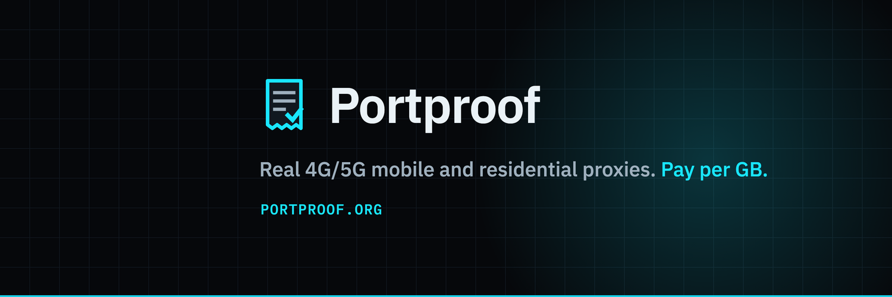

[](https://portproof.org)

# Portproof MCP

**Connect your agent to Portproof.**

Check your GB balance, choose a pool and build a proxy connection from your MCP
client. Mobile 4G/5G and residential traffic share one prepaid balance.

[Website](https://portproof.org) · [Setup guide](https://portproof.org/guides/proxy-mcp-server-for-ai-agents) · [Documentation](https://portproof.org/docs) · [npm](https://www.npmjs.com/package/@portproof/mcp) · [Status](https://portproof.org/status)

Local stdio server · Node.js 20+ · MIT · `@portproof/mcp@0.2.1`

## From settings to a connection

| Your workflow | MCP tools |
| --- | --- |
| Check pricing and current coverage | `get_pricing`, `list_countries`, `get_status` |
| See your remaining traffic | `get_traffic` |
| Choose HTTP or SOCKS5, country and rotation | `build_proxy_url` |
| Test a connection | `test_connection` |
| Buy traffic with your confirmation | `buy_traffic` |

Both pools are shared. A sticky session keeps the same device while it is online;
its IP address may still change.

## Connect an MCP client

Add this to a client supporting local **stdio** MCP servers. You can explore
pricing, service status and current coverage without an API key.

```json
{
  "mcpServers": {
    "portproof": {
      "command": "npx",
      "args": ["-y", "@portproof/mcp@0.2.1"]
    }
  }
}
```

### Claude Desktop

Open **Settings → Developer → Edit Config** and merge the JSON above into
`claude_desktop_config.json`. Keep any existing entries under `mcpServers`.
Save the file, fully quit Claude Desktop, then reopen it.
[Official setup instructions](https://modelcontextprotocol.io/docs/develop/connect-local-servers).

### Cursor

Merge the JSON above into your personal `~/.cursor/mcp.json` file. This makes
Portproof available across your projects without storing account configuration
in a project repository. Check the server in Cursor's MCP settings.
[Official configuration guide](https://cursor.com/docs/mcp).

### Claude Code

Register Portproof in your personal configuration:

```sh
claude mcp add --transport stdio --scope user portproof -- npx -y @portproof/mcp@0.2.1
claude mcp get portproof
```

On native Windows, use `cmd /c npx` in place of `npx` in the first command.
Inside Claude Code, `/mcp` shows the connection status.
[Official stdio setup and user scope](https://code.claude.com/docs/en/mcp).

### Connect your account

Create a key in [your Portproof dashboard](https://portproof.org/app/keys), then
use this account-enabled configuration:

```json
{
  "mcpServers": {
    "portproof": {
      "command": "npx",
      "args": ["-y", "@portproof/mcp@0.2.1"],
      "env": {
        "PORTPROOF_API_KEY": "YOUR_PORTPROOF_API_KEY"
      }
    }
  }
}
```

Keep the real value in your MCP client's private configuration or secret store.
Never commit it to a repository or put it into a prompt. Reading a traffic balance
requires `ports:read`; building proxy URLs, testing connections and buying traffic
require `ports:write`.

For Claude Desktop and Cursor, update the same personal configuration file used
above. For Claude Code, add the `env` object to the `portproof` entry under
`mcpServers` in `~/.claude.json`, then restart the client. Preserve its other
settings. Enter the key in that private file rather than a terminal command.

| Setting | Meaning |
| --- | --- |
| `PORTPROOF_API_KEY` | Optional for public tools; required for account tools |
| `PORTPROOF_API_URL` | Defaults to `https://api.portproof.org`; normally leave unset |

The server runs locally. The API URL above is **not a hosted MCP endpoint**.

## Purchases and connection tests

Keys act on real account credit; there is no sandbox selected by a key prefix.
Connection tests use a small amount of traffic. Purchases require `confirm: true`
and an `idempotency_key`; traffic purchases also require `accept_terms: true`.
The server instructs the client to ask before confirming those actions.
Passwords in generated proxy URLs stay masked unless explicitly requested.

The published bundle also exposes port-management tools; actual availability and
eligibility are determined by the service. See [the documentation](https://portproof.org/docs)
for the current offer and tool behavior.

## About this repository

This is a **release mirror** of `@portproof/mcp` **0.2.1**, containing the published
JavaScript bundle. The shop and original TypeScript development workspace remain
private. [Release provenance](release-provenance.json) records the npm tarball
integrity and published file hashes.

### Run this mirror locally

```sh
git clone https://github.com/portproofas/portproof-mcp.git
cd portproof-mcp
npm ci --ignore-scripts --no-audit --no-fund
npm run check
npm test
node dist/index.js --help
```

For a local MCP client, use `node` with the absolute path to `dist/index.js`.
No build step is required. `package.json` is adapted for standalone installation
and marked private to prevent accidentally republishing the mirror. The npm
package's original manifest is retained as `upstream-package.json`.

The lockfile fixes the dependency versions used by this checkout. GitHub Actions
runs the syntax and smoke checks on Node.js 20, 22 and 24, including a Windows
check on Node.js 22. The smoke tests check the published-file hashes, stdio tool
discovery and purchase guards without using an account or calling the live API.

## Documentation and discovery

- [MCP setup guide](https://portproof.org/guides/proxy-mcp-server-for-ai-agents)
- [API and proxy documentation](https://portproof.org/docs)
- [npm package](https://www.npmjs.com/package/@portproof/mcp)
- Official MCP Registry name: `org.portproof/mcp`
- [Service status](https://portproof.org/status)

`server.json` describes the existing npm release. Its repository field points to
this mirror; updating that local file does not update the hosted Registry.

## Use responsibly

Use Portproof for lawful price monitoring, ad verification, market research,
QA, geo-testing and agent workflows. Follow each destination site's terms and
Portproof's [acceptable-use policy](https://portproof.org/legal/aup).

## License

[MIT](LICENSE). Runtime dependencies retain their own licenses.

---

**Portproof** · [Get proxies](https://portproof.org/shop) · [Contact support](mailto:support@portproof.org)
